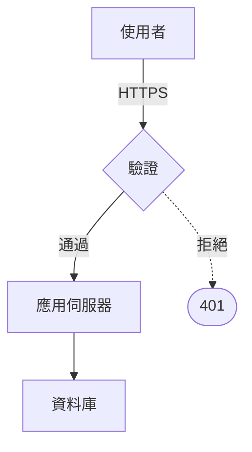

# Diagrams

Write the drawing as Mermaid-flavoured text in `docs/<id>/<name>.mmd`, import
it, and hand it to `<Diagram>`:



```tsx
import { Diagram } from '@open-document/core';
import architecture from './architecture.mmd';

<Diagram chart={architecture} caption="請求路徑" width={420} />
```

It is compiled to SVG at build time and drawn with the document's own theme
variables, so it prints with the same ink and faces as the prose around it.
Never reach for an image of a diagram when the diagram can be written.

Supported:
- `flowchart`/`graph` with `TD` or `LR`; nodes as `A[box]`, `A(round)`, `A([stadium])`, `A[(database)]`, `A{decision}`, `A((circle))`; links `-->`, `---`, `-.->`, `==>` with optional `|labels|`; chains `A --> B --> C`; `subgraph id [Title] ... end` clusters; `%%` comments. A link back to an earlier step is drawn round the side, clear of the steps in between.
- `sequenceDiagram` with `participant Id as Label`, message arrows (`->>`, `-->>`, `->`, `-->`), and `Note over A,B: text` (or `Note left of` / `Note right of`).
- Anything else in Mermaid's syntax is not supported, and a bad diagram fails the build with the line to fix.

Keep `width` inside the text block: a drawing wider than the column is a layout
fault, and `open-doc check` reports it as one.
